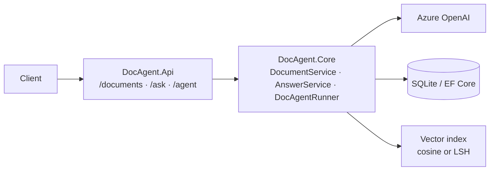

# DocAgent


**An AI document assistant in .NET 8 on Azure: metadata-aware RAG with citations, a tool-calling agent,
specification-driven tests and infrastructure-as-code.**

Live: _add `app_url` from `terraform output` after the first deploy_

<!-- Demo GIF (60 s): upload a document, ask a question, show the cited answer, then an agent question with its trace. -->

## Architecture



1. **Upload**: the document is split into overlapping chunks and each chunk is embedded, stored with its metadata (project, customer, type) and indexed.
2. **Ask**: the question is embedded and the closest chunks are found. If nothing is close enough, it refuses without calling the LLM. Otherwise the model answers in JSON from numbered sources, and the citations are checked in code.
3. **Agent**: the model calls `search_documents`, `list_documents` and `read_document`. Each tool returns only documents from the caller's allowed projects.

More detail: [docs/architecture.md](docs/architecture.md).

## Results

### LSH index vs exact search (from my thesis)

20,000 clustered vectors × 256 dimensions, 100 queries, recall@5 = share of the exact top 5 that LSH also returns.
Measured with `dotnet test -c Release --filter Category=Benchmark` on a laptop (single run):

| Tables | Bits | Recall@5 | ms / query | Speed-up vs exact |
|---:|---:|---:|---:|---:|
| 4 | 8 | 87% | 0.33 | 60.5× |
| 4 | 12 | 65% | 0.07 | 269.3× |
| 4 | 16 | 47% | 0.04 | 454.5× |
| 8 | 8 | 97% | 0.65 | 31.0× |
| 8 | 12 | 84% | 0.12 | 170.0× |
| 8 | 16 | 63% | 0.20 | 101.5× |
| 16 | 8 | 100% | 6.70 | 3.0× |
| **16** | **12** | **97%** | **0.30** | **66.9×** |
| 16 | 16 | 82% | 0.21 | 97.7× |

Exact search: 20.06 ms/query. **Trade-off:** more tables raise recall (more chances to share a bucket). More bits make buckets smaller, so search is faster but recall drops.
16 tables × 12 bits keeps 97% recall at ~67× the speed. Caveats: the exact baseline is a straightforward LINQ sort, not an
optimised scan. Timings from 100 queries are noisy. The data is synthetic (cluster centre + noise), because purely random
high-dimensional vectors are nearly all orthogonal and make nearest-neighbour search meaningless.
At real scale I would use a managed vector store such as Azure AI Search. Writing LSH myself shows what such services do inside.

### Answer quality (AI evaluation)

19 questions over 5 sample documents ([tests/DocAgent.Tests/Eval](tests/DocAgent.Tests/Eval)): 16 answerable and 3 that must be refused.
Run with `dotnet test --filter Category=Eval` (needs a key, see below):

| MinScore | Citation accuracy | Refusal accuracy | False refusals | Avg latency (ms) |
|---:|---:|---:|---:|---:|
| 0.20 | _not run yet_ | | | |
| 0.30 | | | | |
| 0.40 | | | | |

## How it is tested

| Layer | What it checks | Runs |
|---|---|---|
| Unit (xUnit) | Chunker, cosine maths, LSH, citation guardrail, malformed model output, tool access rules | every push |
| BDD acceptance (Reqnroll) | The feature files, end to end through the API with fake AI services | every push |
| Contract | The JSON shape of each endpoint, size limits, behaviour without AI configured | every push |
| LSH benchmark | Recall and speed for 9 LSH settings | on demand |
| AI evaluation | Real answers: right file cited, correct refusals, latency | on demand / weekly (`eval.yml`) |

The specifications were written and committed **before** the feature code. Example:

```gherkin
Feature: Ask questions about documents
  Answers must be grounded in the stored documents and cite them

  Background:
    Given a document "Contract_Acme.txt" in project "Apollo" containing "The Acme contract renews on 1 March 2027."

  Scenario: Answer cites its source
    When I ask "When does the Acme contract renew?"
    Then the answer cites "Contract_Acme.txt"

  Scenario: Refuse to guess when nothing matches
    When I ask "What is the capital of Australia?"
    Then the answer says it could not find this in the documents
```

An LLM can phrase answers differently every run, so the tests never assert wording. They assert what must always be true:
cited file names (structured data), refusal detected *before* the LLM call, and access rules enforced in code.
In CI the AI services are replaced by deterministic fakes, so tests are fast, free and repeatable.

```bash
dotnet test --filter "Category!=Eval&Category!=Benchmark"   # what CI runs (43 tests)
dotnet test -c Release --filter Category=Benchmark --logger "console;verbosity=detailed"
dotnet test --filter Category=Eval --logger "console;verbosity=detailed"
```

## Design decisions

- **Similarity threshold**: when nothing in the documents is close enough, there is no LLM call. That means no tokens spent and no chance to hallucinate.
- **JSON mode**: the model returns `{"answer", "citations"}`, which code can check. Malformed output fails closed to "not found".
- **Citation guardrail**: citations are filtered against the sources actually sent, so the model cannot cite a file it never saw.
- **Access checks inside the tools**, not in the prompt. Even if a document tricks the model ("ignore your instructions…"),
  the tools only return documents from allowed projects. This is proven by `AgentAccess.feature`.
- **AI behind interfaces** (`IEmbeddingService`, `IChatService`): tests swap in fakes, and one factory switches between Azure OpenAI and OpenAI.
- **Validate before touching the AI**: a bad request gets 400 even when the AI is down, and a missing key gives a clear 503.

## How I used AI to build this

> _Write this section in your own words from [docs/ai-log.md](docs/ai-log.md): what the agent did, how you checked it, and what it changed. Give one real example of each. The log records concrete mistakes that were caught. One example: the validation-order bug found by a smoke test that the in-memory tests could not see._

## What I would do next

- Azure AI Search instead of the in-memory index
- Microsoft Entra ID sign-in, with allowed projects read from group claims instead of the `X-Allowed-Projects` demo header
- Batched embedding calls (one call per chunk today) to cut cost and latency
- PDF / Word upload
- Keyless auth with the web app's managed identity (already enabled in Terraform)
- Expose the three tools through an MCP server so assistants can use DocAgent directly

## Run it locally

```bash
cd src/DocAgent.Api
dotnet user-secrets set "AzureOpenAI:Endpoint" "https://<your-resource>.openai.azure.com/"
dotnet user-secrets set "AzureOpenAI:Key" "<your-key>"
#   (or the OpenAI fallback: dotnet user-secrets set "OpenAI:Key" "<key>")
dotnet run --launch-profile http        # http://localhost:5000
```

Then use [DocAgent.Api.http](src/DocAgent.Api/DocAgent.Api.http), or:

```bash
curl -X POST http://localhost:5000/documents -H "Content-Type: application/json" \
  -d '{"fileName":"Contract_Acme.txt","project":"Apollo","customer":"Acme","type":"Contract","content":"The Acme contract renews on 1 March 2027."}'
curl -X POST http://localhost:5000/ask -H "Content-Type: application/json" -d '{"question":"When does the Acme contract renew?"}'
curl -X POST http://localhost:5000/agent -H "Content-Type: application/json" -H "X-Allowed-Projects: Apollo" \
  -d '{"question":"Which contracts do we have for Acme, and when does the newest one renew?"}'
```

Set `Search:Mode` to `lsh` to use the LSH index (tune with `Search:Tables` / `Search:Bits`), and `Rag:MinScore` to change the threshold.

## Deploy

```bash
az login && cd infra
export TF_VAR_subscription_id=$(az account show --query id -o tsv)
export TF_VAR_openai_endpoint="https://<your-resource>.openai.azure.com/"
export TF_VAR_openai_key="<your-key>"
terraform init && terraform plan && terraform apply
```

Then in GitHub, add the web app's publish profile as secret `AZURE_WEBAPP_PUBLISH_PROFILE` and `app_name` as variable
`AZURE_WEBAPP_NAME`, and push to `main`. The deploy job only runs once that variable exists.
The Azure OpenAI resource stays outside Terraform because of student-quota limits. Run `terraform destroy` when you are not demoing.
