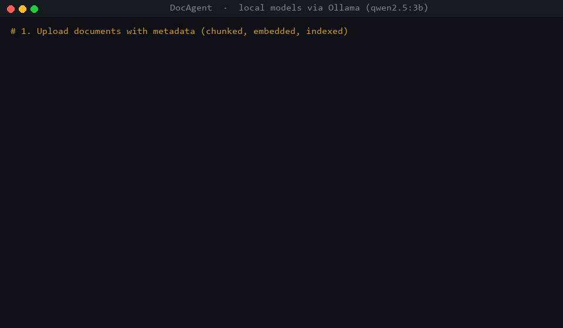
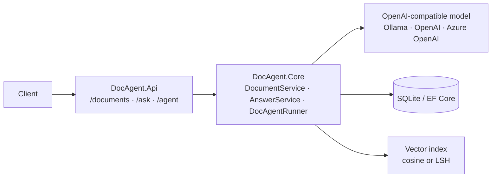

# DocAgent


**An AI document assistant in .NET 8 on Azure: metadata-aware RAG with citations, a tool-calling agent,
specification-driven tests and infrastructure-as-code. Works with any OpenAI-compatible model, including free local models via Ollama.**

Live: _add `app_url` from `terraform output` after the first deploy_



<sub>A real run against free local models (Ollama, qwen2.5:3b) on a laptop CPU. Waiting time is shortened in the animation,
and the real time of each call is shown. The responses are the API's actual output, in [docs/demo](docs/demo).</sub>

## Architecture



1. **Upload**: the document is split into overlapping chunks and each chunk is embedded, stored with its metadata (project, customer, type) and indexed.
2. **Ask**: the question is embedded and the closest chunks are found. If nothing is close enough, it refuses without calling the LLM. Otherwise the model answers in JSON from numbered sources, and the citations are checked in code.
3. **Agent**: the model calls `search_documents`, `list_documents` and `read_document`. Each tool returns only documents from the caller's allowed projects.

More detail: [docs/architecture.md](docs/architecture.md).

## Results

### LSH index vs exact search (from my thesis)

20,000 clustered vectors × 256 dimensions, 100 queries, recall@5 = share of the exact top 5 that LSH also returns.
Measured with `dotnet test -c Release --filter Category=Benchmark` on a laptop (single run):

| Tables | Bits | Recall@5 | ms / query | Speed-up vs exact |
|---:|---:|---:|---:|---:|
| 4 | 8 | 87% | 0.33 | 60.5× |
| 4 | 12 | 65% | 0.07 | 269.3× |
| 4 | 16 | 47% | 0.04 | 454.5× |
| 8 | 8 | 97% | 0.65 | 31.0× |
| 8 | 12 | 84% | 0.12 | 170.0× |
| 8 | 16 | 63% | 0.20 | 101.5× |
| 16 | 8 | 100% | 6.70 | 3.0× |
| **16** | **12** | **97%** | **0.30** | **66.9×** |
| 16 | 16 | 82% | 0.21 | 97.7× |

Exact search: 20.06 ms/query. **Trade-off:** more tables raise recall (more chances to share a bucket). More bits make buckets smaller, so search is faster but recall drops.
16 tables × 12 bits keeps 97% recall at ~67× the speed. Caveats: the exact baseline is a straightforward LINQ sort, not an
optimised scan. Timings from 100 queries are noisy. The data is synthetic (cluster centre + noise), because purely random
high-dimensional vectors are nearly all orthogonal and make nearest-neighbour search meaningless.
At real scale I would use a managed vector store such as Azure AI Search. Writing LSH myself shows what such services do inside.

### Answer quality (AI evaluation)

19 questions over 5 sample documents ([tests/DocAgent.Tests/Eval](tests/DocAgent.Tests/Eval)): 16 answerable and 3 that must be refused.
Measured on a laptop CPU with free local models (Ollama: `qwen2.5:3b` for chat, `nomic-embed-text` for embeddings):

| MinScore | Citation accuracy | Refusal accuracy | False refusals | Avg latency |
|---:|---:|---:|---:|---:|
| 0.30 | 16/16 (100%) | 2/3 (67%) | 0 | 13.4 s* |
| 0.40 | 16/16 (100%) | 3/3 (100%) | 0 | 5.0 s |
| **0.50** | **16/16 (100%)** | **3/3 (100%)** | **0** | **4.4 s** |
| 0.60 | 16/16 (100%) | 3/3 (100%) | 0 | 3.5 s |

\* includes loading the model into memory on the first question.

**What the numbers say:**
- **The threshold is the hallucination guard.** At 0.30 the off-topic question "What is the capital of Australia?" got
  past the threshold, and the model answered "Canberra" from its own knowledge despite the "only from sources" instruction.
  The citation guardrail left it uncited, but it was still an answer that did not come from the documents. From 0.50 up, all three off-topic questions are refused
  **before the LLM is called**, which is also why latency drops.
- **The threshold depends on the embedding model.** With `nomic-embed-text`, real matches scored 0.65–0.79 and off-topic
  questions 0.39–0.42. I use **0.50**, in the middle of that gap. 0.60 also scores 100% but sits close to the weakest real
  match (0.65), so it would start refusing real questions first. OpenAI embeddings use a different scale, so re-run the sweep after switching models.
- Small set (19 questions), one run, one model. It is a regression check, not a benchmark: change the prompt or the
  model, rerun, compare.

**Agent with the same 3B model:** in 4 of 6 runs on document questions it called the tools and answered correctly
(for example `list_documents` → `read_document(2)` → "Liisa Korhonen"). In the other two it asked a clarifying question
or stopped after listing. Multi-step tool use is where a 3B model is weakest. A larger model (qwen2.5:7b, gpt-4o-mini)
is the fix, and the code does not change. The raw runs are in [docs/demo/agent_runs.jsonl](docs/demo/agent_runs.jsonl).

Run it yourself (free, local), or against any provider with the same `AI_*` variables:

```bash
AI_ENDPOINT=http://localhost:11434/v1 AI_CHAT_MODEL=qwen2.5:3b AI_EMBEDDING_MODEL=nomic-embed-text   dotnet test --filter Category=Eval --logger "console;verbosity=detailed"
# choose thresholds with EVAL_MIN_SCORES=0.45,0.5,0.55
```

## How it is tested

| Layer | What it checks | Runs |
|---|---|---|
| Unit (xUnit) | Chunker, cosine maths, LSH, citation guardrail, malformed model output, tool access rules | every push |
| BDD acceptance (Reqnroll) | The feature files, end to end through the API with fake AI services | every push |
| Contract | The JSON shape of each endpoint, size limits, behaviour without AI configured | every push |
| LSH benchmark | Recall and speed for 9 LSH settings | on demand |
| AI evaluation | Real answers: right file cited, correct refusals, latency | on demand / weekly (`eval.yml`) |

The specifications were written and committed **before** the feature code. Example:

```gherkin
Feature: Ask questions about documents
  Answers must be grounded in the stored documents and cite them

  Background:
    Given a document "Contract_Acme.txt" in project "Apollo" containing "The Acme contract renews on 1 March 2027."

  Scenario: Answer cites its source
    When I ask "When does the Acme contract renew?"
    Then the answer cites "Contract_Acme.txt"

  Scenario: Refuse to guess when nothing matches
    When I ask "What is the capital of Australia?"
    Then the answer says it could not find this in the documents
```

An LLM can phrase answers differently every run, so the tests never assert wording. They assert what must always be true:
cited file names (structured data), refusal detected *before* the LLM call, and access rules enforced in code.
In CI the AI services are replaced by deterministic fakes, so tests are fast, free and repeatable.

```bash
dotnet test --filter "Category!=Eval&Category!=Benchmark"   # what CI runs (67 tests)
dotnet test -c Release --filter Category=Benchmark --logger "console;verbosity=detailed"
dotnet test --filter Category=Eval --logger "console;verbosity=detailed"
```

## Design decisions

- **Similarity threshold**: when nothing in the documents is close enough, there is no LLM call. That means no tokens spent and no chance to hallucinate.
- **JSON mode**: the model returns `{"answer", "citations"}`, which code can check. Malformed output fails closed to "not found".
- **Citation guardrail**: citations are filtered against the sources actually sent, so the model cannot cite a file it never saw.
- **Access checks inside the tools**, not in the prompt. Even if a document tricks the model ("ignore your instructions…"),
  the tools only return documents from allowed projects. This is proven by `AgentAccess.feature`.
- **AI behind interfaces** (`IEmbeddingService`, `IChatService`): tests swap in fakes, and one factory picks the provider (Ollama, OpenAI or Azure OpenAI) from configuration alone.
- **Validate before touching the AI**: a bad request gets 400 even when the AI is down, and a missing key gives a clear 503.

## How I used AI to build this

I built DocAgent with a coding agent (Claude Code). I wrote the step-by-step build guide first: the architecture, the
order of the steps, the BDD-first rule and the guardrails I wanted. The agent wrote most of the code from that guide,
in small commits. I made the decisions, and nothing counted as done until it built, passed the tests and worked in a real run.
Every problem is logged in [docs/ai-log.md](docs/ai-log.md).

**How the work was split**
- **Me:** the design and the rules. Specs before code, AI behind interfaces so tests use fakes, access checks in code
  rather than in the prompt, refuse before calling the LLM. I also set the constraints along the way: no Azure OpenAI
  key, so make it provider-neutral; run it for real on free local models; no secrets in Git.
- **The agent:** scaffolding, implementation, tests, CI, Terraform and docs. It also ran the API, the benchmark and the evaluation.
- **Checking:** build output, 67 deterministic tests, smoke tests of the real API with `curl`, and an evaluation against a real model.

**Three things that were caught, and how**
1. **A test setup that hid a bug.** A bad upload returned 500 instead of 400 when no AI key was configured, because ASP.NET
   built the AI client before the validation code ran. The in-memory tests always register fakes, so they could not see it.
   A `curl` smoke test of the real API with no keys found it. Fix: validate first, then resolve AI services, and return a
   clear 503 when AI is missing. `ApiWithoutAiTests` now guards it.
2. **Code that passed every test but failed on a real model.** With Ollama, correct answers came back as "I could not find
   this". The small model cited source *numbers* (`[1]`) rather than file names, and the strict parser failed closed.
   Comparing the raw model reply with the API response showed the cause. Citations are now mapped to the sources that were
   actually sent, so the guardrail still holds.
3. **A threshold copied from a guide.** `MinScore = 0.30` let "What is the capital of Australia?" through, and the model
   answered from its own knowledge. Printing similarity scores showed that `nomic-embed-text` scores off-topic questions at
   0.39–0.42. I set the threshold to 0.50 from the evaluation sweep (see Results).

There were thirteen problems in total, including agent tools that treated a small model's empty filters as "match nothing", an old AMD GPU that produced garbage output, runaway generation with no
output cap, and an SDK method that could only parse base64 embeddings.

**What I learned:** all the deterministic tests passed before the first real-model run, and that run still found four
problems. Fakes prove the logic, and only an evaluation against the real model proves the behaviour. That is why the project
has both, and why the evaluation runs weekly in CI. The agent was fast at writing code. The value came from deciding what
to build, setting the checks, and not trusting output that had not been run.

## What I would do next

- Azure AI Search instead of the in-memory index
- Microsoft Entra ID sign-in, with allowed projects read from group claims instead of the `X-Allowed-Projects` demo header
- Batched embedding calls (one call per chunk today) to cut cost and latency
- PDF / Word upload
- Keyless auth with the web app's managed identity (already enabled in Terraform)
- Expose the three tools through an MCP server so assistants can use DocAgent directly

## Run it locally

DocAgent works with any OpenAI-compatible provider, configured in one `AI` section (`Endpoint`, `Key`, `ChatModel`, `EmbeddingModel`).
The free option needs no key: [Ollama](https://ollama.com) runs the models on your own machine.

```bash
# 1. Free, local models (one-time download, a few GB)
ollama pull qwen2.5:3b          # chat model with tool calling + JSON mode (qwen2.5:7b is better if you have a GPU)
ollama pull nomic-embed-text    # embedding model (768 dimensions)

# 2. Point DocAgent at it
cd src/DocAgent.Api
dotnet user-secrets set "AI:Endpoint" "http://localhost:11434/v1"
dotnet user-secrets set "AI:ChatModel" "qwen2.5:3b"
dotnet user-secrets set "Rag:MinScore" "0.5"          # tuned for nomic-embed-text, see Results
dotnet user-secrets set "AI:EmbeddingModel" "nomic-embed-text"

# 3. Run
dotnet run --launch-profile http        # http://localhost:5000
```

Other providers only change the settings:

| Provider | `AI:Endpoint` | `AI:Key` | Models |
|---|---|---|---|
| Ollama (free, local) | `http://localhost:11434/v1` | — | e.g. `qwen2.5:3b`, `nomic-embed-text` |
| OpenAI | _(empty)_ | `sk-...` | `gpt-4o-mini`, `text-embedding-3-small` (defaults) |
| Azure OpenAI | `https://<res>.openai.azure.com/` (detected automatically) | key | your deployment names |

Switching embedding models changes the vector size, so delete `docagent.db` and upload again after a switch.
Each model scores similarity differently, so re-tune `Rag:MinScore` with the evaluation for the model you use.
Without any provider configured, the API still starts: listing works, and the AI endpoints return a clear 503.

Then use [DocAgent.Api.http](src/DocAgent.Api/DocAgent.Api.http), or:

```bash
curl -X POST http://localhost:5000/documents -H "Content-Type: application/json" \
  -d '{"fileName":"Contract_Acme.txt","project":"Apollo","customer":"Acme","type":"Contract","content":"The Acme contract renews on 1 March 2027."}'
curl -X POST http://localhost:5000/ask -H "Content-Type: application/json" -d '{"question":"When does the Acme contract renew?"}'
curl -X POST http://localhost:5000/agent -H "Content-Type: application/json" -H "X-Allowed-Projects: Apollo" \
  -d '{"question":"Which contracts do we have for Acme, and when does the newest one renew?"}'
```

Set `Search:Mode` to `lsh` to use the LSH index (tune with `Search:Tables` / `Search:Bits`), and `Rag:MinScore` to change the threshold.

## Deploy

The app in Azure needs a provider it can reach over the internet. A local Ollama is not reachable from App Service,
so the live demo needs a hosted OpenAI-compatible key (OpenAI, or Azure OpenAI if your subscription gets access).

```bash
az login && cd infra
export TF_VAR_subscription_id=$(az account show --query id -o tsv)
export TF_VAR_ai_key="<your-key>"
# export TF_VAR_ai_endpoint="https://<res>.openai.azure.com/"   # only for Azure OpenAI or another hosted endpoint
terraform init && terraform plan && terraform apply
```

Then in GitHub, add the web app's publish profile as secret `AZURE_WEBAPP_PUBLISH_PROFILE` and `app_name` as variable
`AZURE_WEBAPP_NAME`, and push to `main`. The deploy job only runs once that variable exists.
Run `terraform destroy` when you are not demoing.
