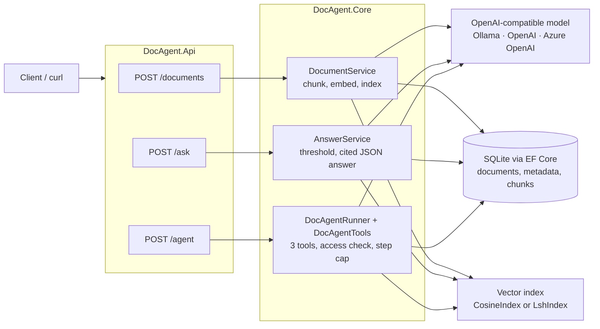

# Architecture

GitHub Actions builds, tests and deploys to Azure App Service. Terraform provisions it. Application Insights monitors it.

## Request flows

**Upload** — validate → split into ~800-char chunks with 100-char overlap → embed each chunk → save document + chunks
(embeddings stored as JSON) → add vectors to the in-memory index. On startup all stored vectors are reloaded into the index.

**Ask** — embed the question → top 20 chunks from the index → optional project filter → top 5 →
if the best score is below `MinScore`, answer "not found" **without calling the LLM** → otherwise send numbered sources
to the chat model in JSON mode → drop any citation that was not among the sources.

**Agent** — the model gets three tools (`search_documents`, `list_documents`, `read_document`) and decides which to call.
`DocAgentRunner` runs each call through `DocAgentTools`, which filters every query by the caller's allowed projects,
caps the loop at 6 steps and records a trace.

## Where the safety lives

| Risk | Defence | Where |
|---|---|---|
| Hallucinated answer when nothing matches | Similarity threshold before the LLM call | `AnswerService.MinScore` |
| Model cites a file it never saw | Citations filtered against the sources in code | `AnswerService` guardrail |
| Malformed model output | Fail closed to "not found" | `AnswerService` |
| Prompt injection in a document | Prompt says sources are data; tools enforce access in code, so a tricked model still cannot reach other projects | `DocAgentTools`, `AgentAccess.feature` |
| Cost abuse | Fixed-window rate limit on `/ask` and `/agent`; size limits on uploads (200 KB) and questions (1,000 chars) | `Program.cs` |
| Leaked secrets | user-secrets locally, sensitive Terraform variables, app settings in Azure; managed identity ready | `infra/` |
